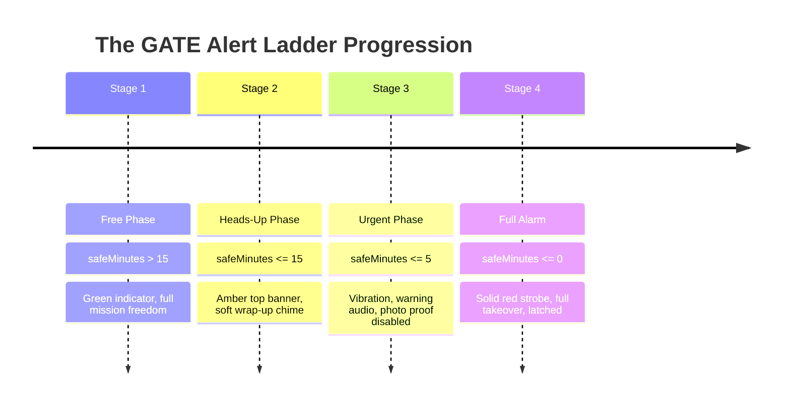

# GATE — Alarm Design & Alert Ladder Architecture

**Last Verified:** 2026-10-11 · **Commit:** `83f76bc`

---

## 1. Zero-Dependency Alarm Philosophy

In mobile web applications, alarms frequently fail due to:
1. Browser autoplay audio restrictions.
2. Background tab process suspension and timer drift.
3. Network latency or server downtime during final boarding calls.

GATE solves all three issues through a hardened client-side alarm engine implemented in `src/lib/alarm.ts` and `src/lib/time.ts`.

---

## 2. Audio Arming & Autoplay Policy Bypass

iOS Safari and Chromium browsers strictly disallow programmatic WebAudio or `<audio>` playback unless the audio context was previously unlocked by a direct user gesture.

GATE arms audio during the user's initial **START** tap:
```typescript
// Inside src/lib/alarm.ts arm()
export function arm(): void {
  try {
    const audio = getAudio();
    audio.play().then(() => {
      audio.pause();
      audio.currentTime = 0;
    }).catch(() => {});
  } catch (e) {
    // Audio pre-warming fallback
  }

  // Also unlock WebAudio AudioContext
  try {
    const ctx = getAudioContext();
    if (ctx && ctx.state === 'suspended') {
      ctx.resume().catch(() => {});
    }
  } catch (e) {}
}
```

### Triple Audio Redundancy:
1. **Primary**: High-volume airport chime audio (`/alarm.mp3`).
2. **Secondary WebAudio Fallback**: A custom dual-oscillator synthesizer generating a piercing 880 Hz / 440 Hz square wave pattern (`playOscillatorAlarm()`), requiring zero external audio files.
3. **Hardware Vibration**: Triggers alternating 500ms vibration pulses on devices supporting the Web Vibration API.
4. **Screen Wake Lock**: Acquires a continuous `navigator.wakeLock.request('screen')` on START to keep mobile displays illuminated.

---

## 3. The Alert Ladder Timeline

GATE evaluates remaining safe minutes every second:
$$\text{safeMinutes} = \frac{\text{departureMs} - (\text{walkMin} + \text{bufferMin}) \cdot 60000 - \text{now}}{60000}$$



### Threshold Comparison:

| Phase | Normal Mode Threshold | Demo Mode Threshold (60s) | Visual Effect | Sound & Haptics |
|---|---|---|---|---|
| **Free** | $> 15$ min safe time | $> 20$ s remaining | Clean dark theme | None |
| **Heads-up** | $\le 15$ min safe time | $\le 20$ s remaining | Top amber banner: `START WRAPPING UP` | Soft single chime |
| **Urgent** | $\le 5$ min safe time | $\le 10$ s remaining | Red top banner: `WALK TO GATE NOW` | Warning audio + vibration |
| **ALARM** | $\le 0$ min safe time | $\le 0$ s remaining | Full-screen red strobe `#C8201A` $\leftrightarrow$ `#7A120E` | High-volume alarm + oscillator + pulse vibration |

---

## 4. The Alarm Screen Latch

When `safeMinutes <= 0`:
1. The app immediately latches into `screen: 'alarm'`.
2. All background tours, tips, or proof modals are destroyed instantly.
3. There is no back button, close button, or swipe-to-dismiss.
4. The screen displays the exact departure place in huge monospace digits (up to `40vw`).
5. Only tapping the single high-contrast button **"I AM AT THE GATE"** (or platform/stop) transitions the traveler safely to the completion screen.
