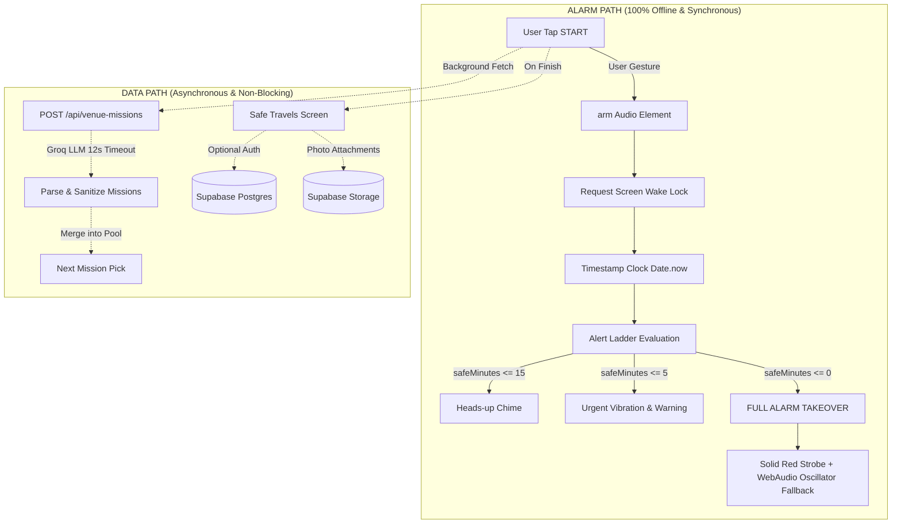
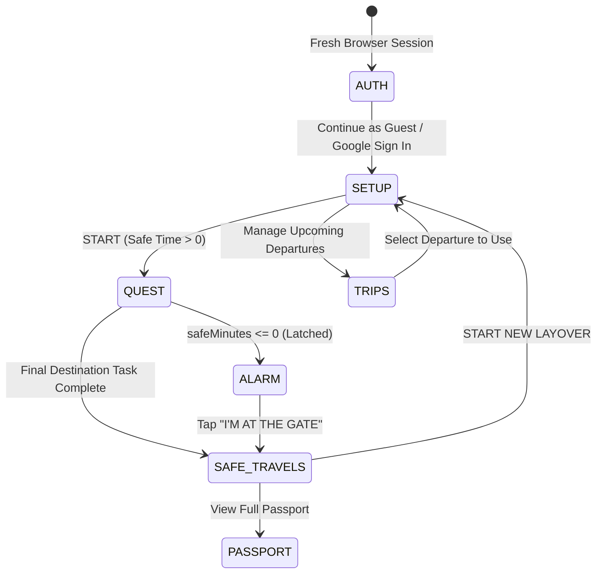

# GATE — System Architecture

**Last Verified:** 2026-10-11 · **Commit:** `98bad9e`

---

## 1. Architectural Philosophy

GATE is an airport-signage-inspired, mobile-first layover companion web app built under a strict reliability invariant:
> **The alarm path must never depend on the network, database, authentication, camera, or AI.**

If every cloud service suffers an outage, the traveler's alarm clock, audio escalation, and local quest loop continue operating without delay or disruption.

---

## 2. Dual-Engine Model: Alarm Path vs Data Path

### Invariants:
1. **Zero-Blocking START**: The client START click handler records epoch milliseconds directly from `Date.now()`, arms the audio context synchronously, and transitions to the quest screen in $< 16$ms. It never `await`s the network.
2. **Deterministic Stat Calculations**: Mission stat boosts (+20 to +30 hunger/sanity/battery) and XP rewards (`MISSION_XP = 40`, `PROOF_BONUS_XP = 20`) are computed deterministically in application code via `deriveStatEffect(tag)`, never derived from AI output.
3. **Emergency Unmount**: If the alert ladder reaches `urgent` ($\le 5$ min) or `alarm` ($\le 0$ min), all non-essential UI (onboarding tours, context tips, photo modals) unmounts immediately. The alarm layer has `z-index: 100`, superseding every other interface surface.

---

## 3. Screen State Machine

---

## 4. Time Math & Clock Resiliency

- All time in GATE is represented as **epoch milliseconds** (`number`). Date objects are never stored in session state.
- **Throttling Immunity**: Browsers throttle background tab `setInterval` timers down to 1 tick per minute. To prevent time drift, the `useNow` hook derives current time strictly from `Date.now()` on every render and synchronizes on document `visibilitychange`.
- **Midnight Rollover**: If the user enters a departure time earlier than the current local time, `nextOccurrence()` automatically rolls the schedule to tomorrow's date.
