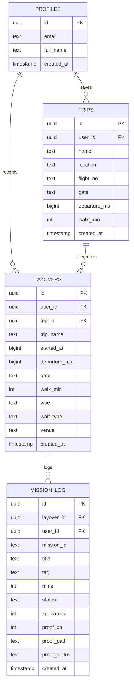

# GATE — Database Architecture & Row Level Security

**Last Verified:** 2026-10-11 · **Commit:** `83f76bc`

---

## 1. Schema Overview

GATE uses Supabase (PostgreSQL 15) for multi-session data persistence, upcoming departures management, and photo proof storage.

All SQL migrations live in `gate-next/supabase/migrations/`:
- `0001_init.sql` — Core profiles, layovers, and mission logs with Row Level Security.
- `0002_trips.sql` — Upcoming user departures table, foreign key constraints, and 50-trip abuse limit trigger.
- `0003_proofs.sql` — Private storage bucket `proofs`, photo verification schema, and storage RLS policies.

---

## 2. Entity-Relationship Diagram



---

## 3. Mathematical Proof of Row Level Security (RLS)

Every table has Row Level Security explicitly enabled (`ALTER TABLE ... ENABLE ROW LEVEL SECURITY`).

### 1. `profiles` Table
```sql
CREATE POLICY "Users can read own profile" ON profiles
    FOR SELECT USING (auth.uid() = id);
CREATE POLICY "Users can update own profile" ON profiles
    FOR UPDATE USING (auth.uid() = id);
```

### 2. `trips` Table
```sql
CREATE POLICY "Users can manage own trips" ON trips
    FOR ALL USING (auth.uid() = user_id)
    WITH CHECK (auth.uid() = user_id);
```
**Protection**: It is mathematically impossible for an authenticated user to query, edit, or delete departures belonging to any other user.

### 3. Cross-User Foreign Key Integrity
```sql
CREATE POLICY "Users can manage own layovers" ON layovers
    FOR ALL USING (auth.uid() = user_id)
    WITH CHECK (
        auth.uid() = user_id AND
        (trip_id IS NULL OR EXISTS (
            SELECT 1 FROM trips WHERE trips.id = trip_id AND trips.user_id = auth.uid()
        ))
    );
```
**Protection**: Prevents relational spoofing. An attacker cannot bind their layover to another traveler's private `trip_id`.

### 4. Storage Bucket Policies (`proofs`)
The `proofs` bucket enforces strict user folder isolation:
- File paths are forced to match: `{auth.uid()}/{layoverId}/{logId}.jpg`.
- Read policy: `auth.uid()::text = (storage.foldername(name))[1]`.
- Write policy: `auth.uid()::text = (storage.foldername(name))[1]`.
- File size limit: Hard-capped at 1 MB per file; MIME type restricted to `image/jpeg`.

---

## 4. Abuse Protection: The 50-Trip Cap Trigger

To prevent database bloating during public hackathon demonstrations, `0002_trips.sql` defines an automated PostgreSQL trigger:

```sql
CREATE OR REPLACE FUNCTION enforce_max_trips()
RETURNS TRIGGER AS $$
BEGIN
    IF (SELECT COUNT(*) FROM trips WHERE user_id = NEW.user_id) >= 50 THEN
        RAISE EXCEPTION 'TRIP_LIMIT_REACHED: Maximum 50 departures allowed per traveler';
    END IF;
    RETURN NEW;
END;
$$ LANGUAGE plpgsql;
```
